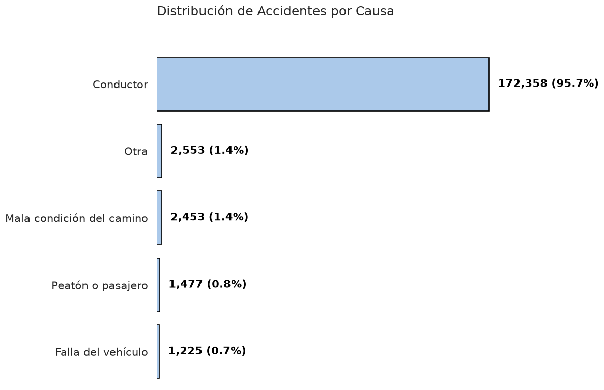
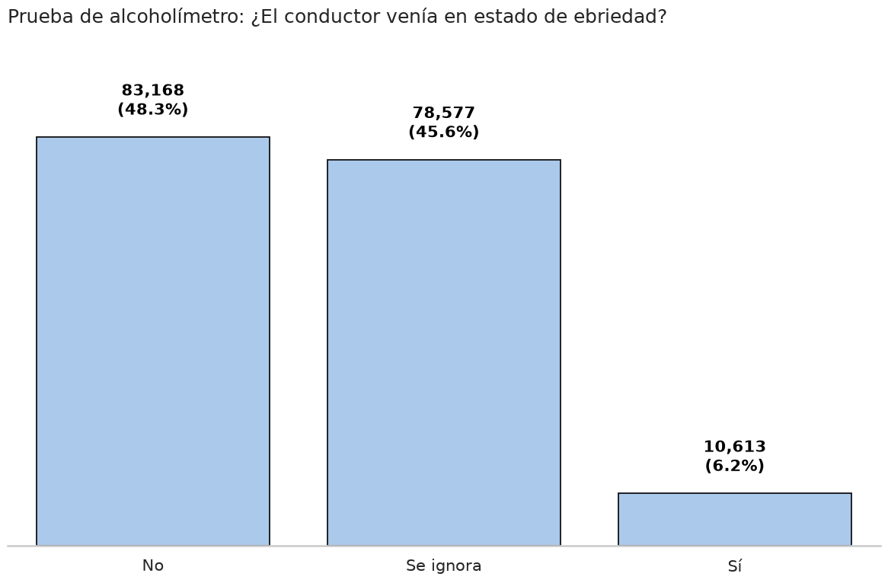

# Registro de accidentes viales (2015)

### ¿Alguna vez te ha pasado que estás en una reunión familiar y escuchas que a un tío, una prima o a un amigo "le chocaron"? dentro de nuestra cultura de calidez está el apoyar a nuestros seres queridos y automáticamente asumir que todo el mundo tiene la culpa de lo sucedido menos ellos; es decir, la culpa es del peatón que no se fijó que venía carro o quizás fue culpa del otro "wey" que se incorporó  al carril en un boulevard o, incluso, puede que directamente le echemos la culpa al deplorable estado de las calles, a la infrastructura vial y a la cultura del automovilista en general.
### Bueno, en esta lectura se ilustrará la información que posee una base de datos de accidentes viales que corresponde al año 2015, en donde a lo largo de 16 estados de la república se registraron más de 180,000 accidentes. Veamos qué dicen los datos sobre el responsable del accidente.

>### De cada 10 accidentes, 9 fueron causados por el conductor.
### La base de datos refleja una realidad aplastante: si bien no se tiene acceso a qué estados de la república en específico se utilizaron para esta muestra, los datos evidencian un problema muy focalizado, así que a partir de aquí el análisis se concentrará en estos 172 mil casos en donde el causante fue el conductor. ¿Será que una parte significativa de estos casos se debe al uso del teléfono celular mientras el conductor estaba al volante? ¿Vendría el conductor en sus cinco sentidos?

### La mitad de los conductores pasaron la prueba del alcoholímetro y solo un 7% resultó positivo, pero entonces... ¿Qué pasa con ese 43% que está sin identificar? Solo con esta información no se puede sacar ninguna conclusión contundente sobre el estado de ebriedad; sin embargo, consideramos curioso que sea un porcentaje tan alto el que "se ignore".
